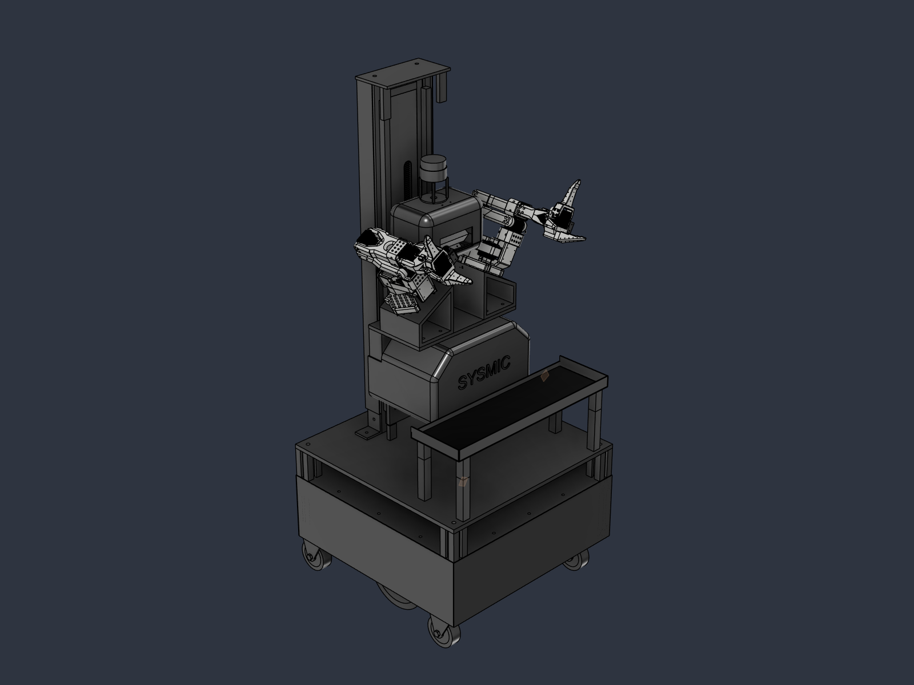
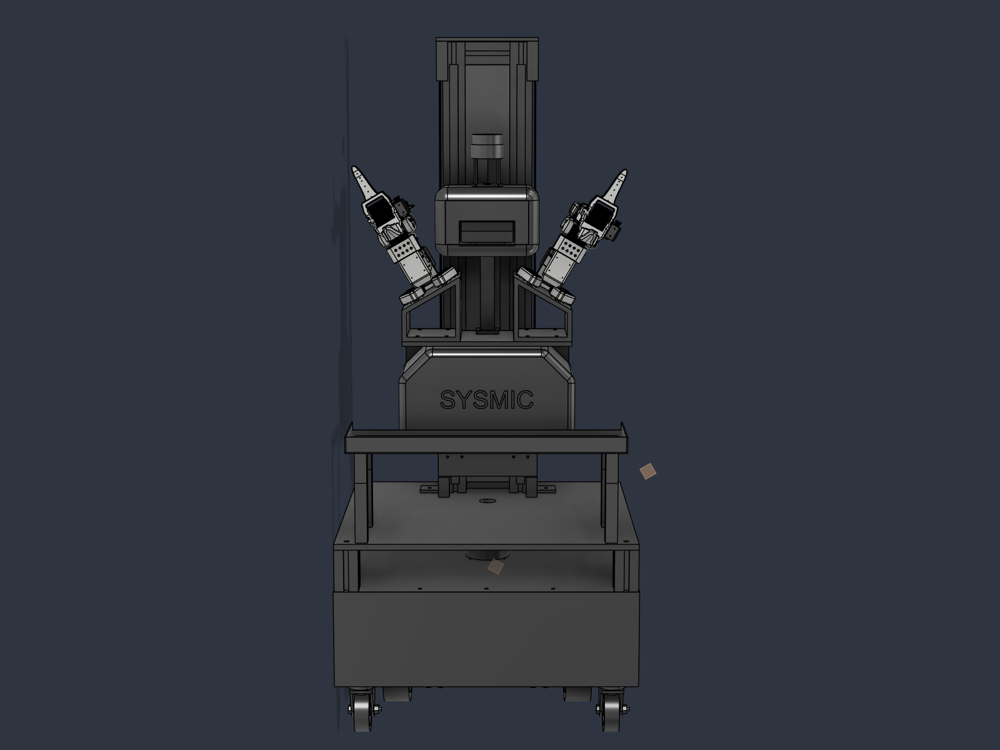
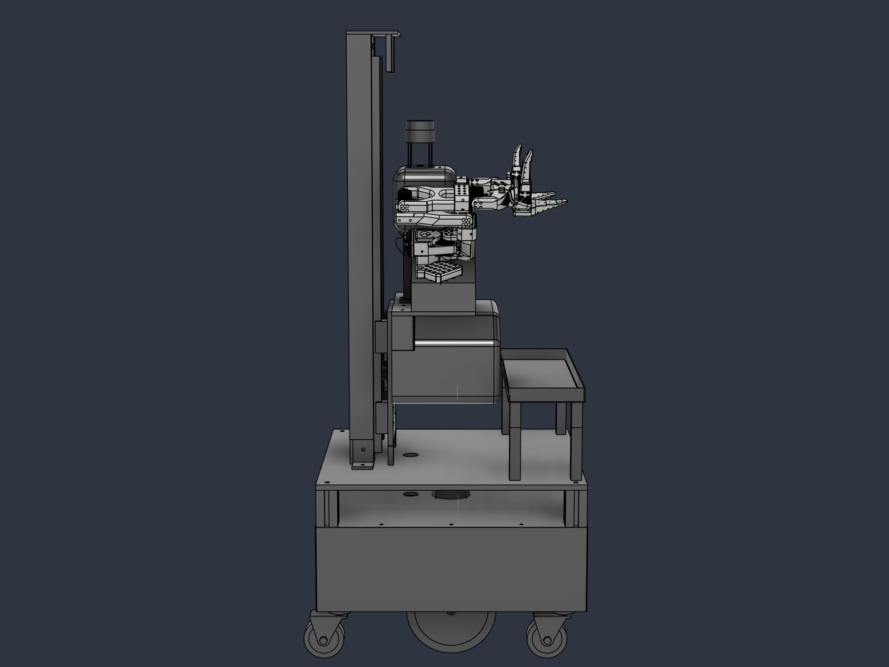
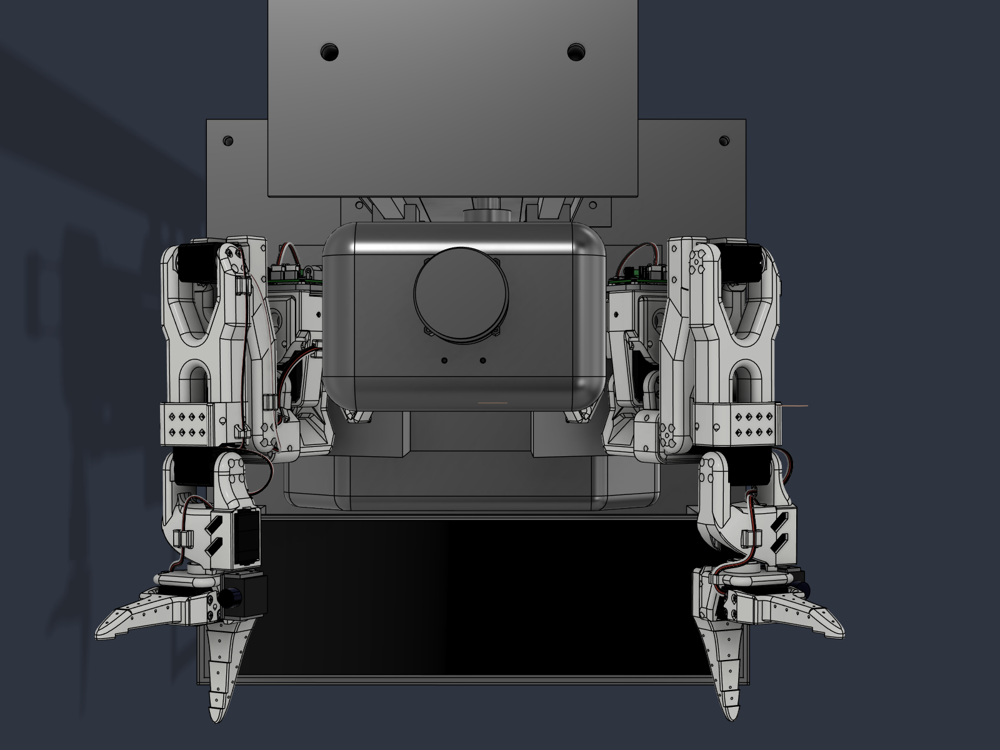

# SYSMIC 2.0 – URDF

URDF of the SYSMIC 2.0 .



| Front | Side |
|---|---|
|  |  |



Parts you can see: wheeled base with the tray on top, the tall lift column at the back, the torso with the camera on top, and two arms on either side.

## What's in it
- Differential-drive base (2 drive wheels, 4 casters)
- Rack-and-pinion lift (prismatic, 0 to 0.4477 m)
- Two SO-101 arms, 6 joints each (pan, shoulder, elbow, wrist flex, wrist roll, gripper)
- Base tray at z = 491 mm (checked in CAD: both arms reach it with no collisions)

26 links, 25 joints, root link `base_link`.

## Files
- `sysmic.urdf` – the robot description
- `meshes/` – STL files (metres)

## Notes
- Units: metres, radians, kg. Frame: +X forward, +Z up. Zero pose.
- Joint limits for the arms come from the CAD. Effort and speed limits are placeholders.
- Mass comes from the CAD; inertia is a rough box estimate.
- Head pan joint is not included yet.
- Arm meshes include screws and are heavy (about 115 MB total).

## View it
```
pip install yourdfpy
python -c "import yourdfpy; yourdfpy.URDF.load('sysmic.urdf').show()"
```
Or load `sysmic.urdf` in RViz / Gazebo (mesh paths are relative: `meshes/...`).
